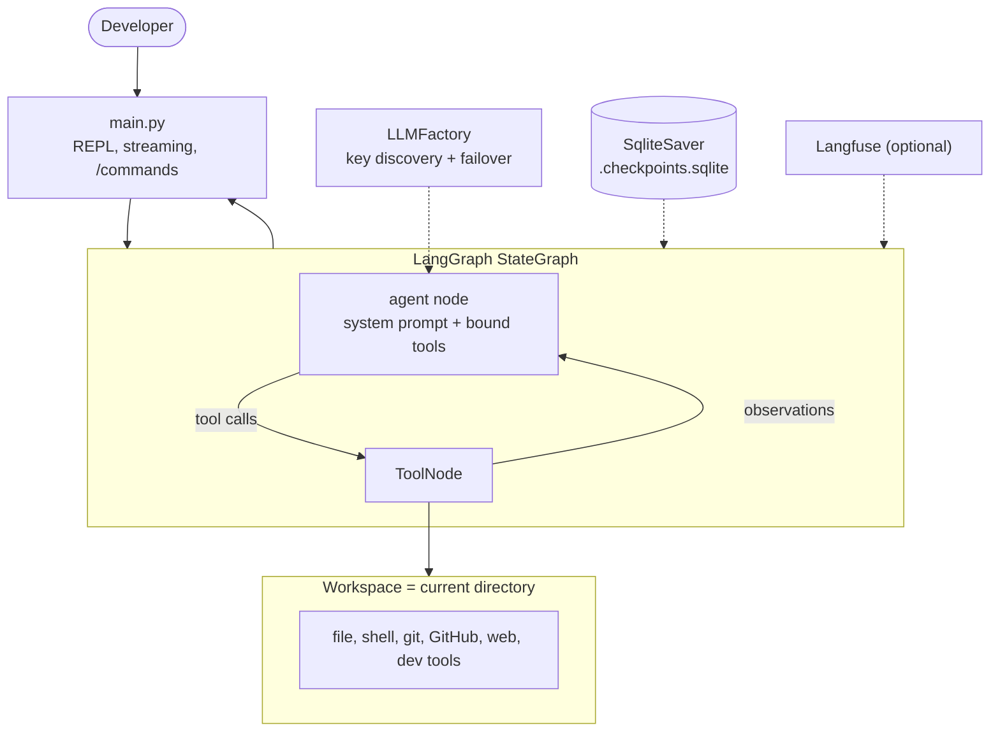

# KRATOS — Autonomous Coding Agent

> A terminal coding agent that reads your codebase, plans a change, edits files, runs tests, and reports what it did.

KRATOS is a read-write coding agent built on **LangGraph**. It runs in the project directory you launch it from, uses the tools it needs (search, read, edit, shell, git, GitHub, web), and verifies its own work before answering.


---

## Overview

Most coding assistants only talk about code. KRATOS operates on it:

```text
You: "My tests are failing, fix them."

KRATOS -> runs pytest
       -> reads the failing file
       -> traces the failure through the codebase
       -> applies a minimal edit
       -> re-runs the tests
       -> explains what changed and why
```

Every task follows a four-phase loop:

```text
EXPLORE  ->  ANALYSE  ->  ACT  ->  VERIFY
 search       impact       edit     tests
 read         reasoning    write    re-read
```

The agent is intentionally small and readable: a LangGraph state machine, a tool layer, a provider factory, a permission gate, and a skill library.

---

## Highlights

- **Real file editing** — `edit_file` requires an exact, unique match before replacing text. No blind overwrites.
- **Shell verification** — runs tests, linters, and git commands to check its own work.
- **Multi-provider LLM support** — OpenAI, Groq, Gemini, Omniroute, and optional local Ollama.
- **Automatic failover** — rotates across discovered API keys, skips quota-exhausted providers for a cooldown, retries transient failures, and fails loudly with every provider error.
- **Live model switching** — `/model groq`, `/model gemini`, `/model openai`, `/model omniroute`, `/model ollama` change provider mid-conversation without losing history.
- **Persistent memory** — SQLite checkpoints keep conversations across restarts.
- **Context windowing** — recent turns are kept in full; older turns are compressed into a short summary.
- **Token streaming** — responses appear as they are generated.
- **Workspace guard** — file tools refuse paths outside the launch directory.
- **Confirmation gate** — writes, shell commands, deletes, issue creation, and every git operation ask for approval first.
- **Skill library** — Markdown playbooks the agent loads on demand for web, GitHub, git, filesystem, testing, and coding work.
- **Optional tracing** — Langfuse integration when explicitly enabled.

---

## How it works



A request moves through the graph like this:

1. `main.py` reads a query and attaches a `thread_id`.
2. The `agent` node builds a system prompt, loads recent history, and calls the selected LLM with the tool schema.
3. If the model emits tool calls, `ToolNode` runs them and returns observations.
4. The loop repeats until the model replies without tool calls.
5. Tokens stream to the terminal and the turn is saved to the SQLite checkpointer.

---

## Tool reference

### Core workspace

| Tool | Purpose |
|---|---|
| `list_files` | List project files (skips `.git`, virtualenvs, `node_modules`, caches, dot-directories) |
| `read_file` | Read a file inside the workspace |
| `search_code` | Case-insensitive text search across source and docs |
| `write_file` | Create or overwrite a file |
| `edit_file` | Exact-match replace; fails if the match is missing or ambiguous |
| `run_command` | Run a shell command in the workspace (120 s timeout) |
| `web_search` | DuckDuckGo search for docs and error solutions |

### Web

| Tool | Purpose |
|---|---|
| `fetch_url` | Fetch a page with Scrapling, extract main article text with trafilatura, fall back to `requests` |
| `scrape_github_file` | Read a file from a GitHub blob/raw URL |

### GitHub

| Tool | Purpose |
|---|---|
| `github_read_file` | Read a file from a public repository |
| `github_search_code` | Search code across GitHub |
| `github_list_issues` | List issues (pull requests excluded) |
| `github_list_prs` | List pull requests |
| `github_create_issue` | Create an issue (requires `GITHUB_TOKEN`) |

### Local git

| Tool | Purpose |
|---|---|
| `git_status`, `git_diff`, `git_log` | Inspect the repository |
| `git_checkout`, `git_commit`, `git_push`, `git_clone` | Branch, commit, push, clone |

### Filesystem and dev workflow

| Tool | Purpose |
|---|---|
| `glob_files`, `create_directory`, `move_file`, `delete_file` | Find and organize files inside the workspace |
| `run_tests`, `lint_code` | Run pytest/jest or ruff/eslint and return a pass/fail summary |

### Skills

| Tool | Purpose |
|---|---|
| `list_skills` | Show the installed skill playbooks |
| `load_skill` | Load a skill's full instructions before acting |

---

## Skills

Skills are Markdown guides in `agent/skills/`. The system prompt carries a one-line index; when a request matches, the agent loads the full guide and follows it.

| Skill | Use for |
|---|---|
| `coding` | The default explore, analyse, act, verify loop |
| `web` | Web search, fetching a URL, scraping a GitHub file |
| `github` | Reading files, searching code, issues, pull requests |
| `git` | Local status, diff, log, branch, commit, push, clone |
| `filesystem` | Finding, creating, moving, and deleting files |
| `testing` | Running tests and linters, verifying changes |

Add a skill by dropping a `<name>.md` file with `name`, `description`, and `triggers` frontmatter into `agent/skills/`. No code change is required.

---

## Setup guide

### Prerequisites

- Python **3.10+**
- `git`
- At least one supported LLM API key
- Optional: a local [Ollama](https://ollama.com/) installation

### 1. Clone and enter the project

```bash
git clone https://github.com/Skalith/codebase-agent.git
cd codebase-agent
```

### 2. Create a virtual environment

```bash
python -m venv venv
source venv/bin/activate        # Windows: venv\Scripts\activate
```

### 3. Install dependencies

```bash
pip install --upgrade pip
pip install -r requirements.txt
```

### 4. Configure credentials

```bash
cp .env.example .env
```

Open `.env` and add at least one provider key:

```ini
GROQ_API_KEY=your-key-here
```

The factory discovers any environment variable that starts with a supported provider prefix. To register more than one key for the same provider, add a suffix:

```ini
GROQ_API_KEY_1=...
GROQ_API_KEY_2=...
GEMINI_API_KEY_1=...
```

### 5. Run

```bash
python main.py
```

To select a provider explicitly:

```bash
python main.py --model groq
# or inside the session:
/model groq
```

### 6. Optional: install a global launcher

This wrapper reuses the project virtualenv, so `kratos` works from any directory.

```bash
mkdir -p ~/.local/bin
cat > ~/.local/bin/kratos <<EOF
#!/usr/bin/env bash
exec "$(pwd)/venv/bin/python" "$(pwd)/main.py" "\$@"
EOF
chmod +x ~/.local/bin/kratos
export PATH="$HOME/.local/bin:$PATH"
```

Then, in any project:

```bash
cd ~/your-project
kratos
```

### 7. Verify the installation

```bash
pytest tests/ -q
```

The suite is fully offline and does not need API keys.

---

## Usage

```text
$ kratos

KRATOS -> "find where authentication is handled and add a missing test"

  [explore]  search_code("authenticate")
  [read]     auth/service.py
  [analyse]  the token check skips expiry
  [act]      edit_file("auth/service.py", ...)
  [verify]   run_tests("tests/test_auth.py")
  [done]     added one test and fixed the expiry check
```

### In-session commands

| Command | Action |
|---|---|
| `/model` | Show the current provider and available providers |
| `/model <name>` | Switch provider without losing conversation history |
| `/new` | Start a fresh conversation thread |
| `exit` or `quit` | Leave the session |

---

## Configuration

All configuration is read from `.env` or the process environment.

| Variable | Required | Purpose |
|---|---|---|
| `OPENAI_API_KEY` | One provider | OpenAI key |
| `GROQ_API_KEY` | One provider | Groq key |
| `GEMINI_API_KEY` | One provider | Google Gemini key |
| `OMNIROUTE_API_KEY` | One provider | Local Omniroute endpoint at `http://localhost:20128/v1` |
| `ENABLE_OLLAMA` | No | Set to `1` to allow the local Ollama fallback (`qwen2.5-coder`) |
| `GITHUB_TOKEN` | No | GitHub API token; required for `github_create_issue`, recommended for search |
| `ENABLE_LANGFUSE` | No | Set to `1` to enable Langfuse tracing |
| `LANGFUSE_PUBLIC_KEY` | No | Langfuse public key |
| `LANGFUSE_SECRET_KEY` | No | Langfuse secret key |
| `LANGFUSE_BASE_URL` | No | Langfuse host (for example `https://cloud.langfuse.com`) |
| `KRATOS_MODEL` | No | Default provider (`auto`, `openai`, `groq`, `gemini`, `omniroute`, `ollama`) |
| `KRATOS_YES` | No | Set to `1` to auto-approve tool prompts (tests and automation) |

Provider failover order is **Gemini -> Groq -> Omniroute -> any other configured provider**. A provider that reports quota exhaustion is skipped for 300 seconds; transient server errors are retried up to two times.

---

## Project structure

```text
codebase-agent/
├── main.py                  # CLI entry point: splash, streaming, /commands
├── requirements.txt
├── .env.example             # Documented configuration template
├── agent/
│   ├── graph.py             # LangGraph agent <-> ToolNode loop, failover, context window
│   ├── tools.py             # Core workspace tools and path guard
│   ├── tools_web.py         # fetch_url, scrape_github_file
│   ├── tools_git.py         # Local git tools
│   ├── tools_github.py      # GitHub API tools
│   ├── tools_fs.py          # glob, mkdir, move, delete
│   ├── tools_dev.py         # run_tests, lint_code
│   ├── skills.py            # Skill loader and list/load tools
│   ├── skills/              # Markdown skill playbooks
│   ├── approvals.py         # y/N confirmation prompt
│   ├── permissions.py       # Gated vs read-only tool policy
│   ├── llm_factory.py       # Provider discovery, rotation, model selection
│   ├── memory.py            # SqliteSaver checkpointer with in-memory fallback
│   ├── paths.py             # Project root and checkpoint path
│   └── tracing.py           # Optional Langfuse callbacks
├── tests/
│   └── test_agent.py        # 45 offline tests
└── conftest.py              # Pytest configuration
```

Generated at runtime and excluded from git:

- `.env`
- `.checkpoints.sqlite`
- `.pytest_cache/`
- `__pycache__/`

---

## Safety model

KRATOS edits real files and runs real commands. The safety contract is:

1. **Workspace isolation for file tools.** `read_file`, `write_file`, `edit_file`, `create_directory`, `move_file`, and `delete_file` resolve paths with `os.path.realpath` and refuse anything outside the launch directory.
2. **Explicit approval for state changes.** The following tools ask `y/N` before running:
   - `write_file`, `edit_file`, `run_command`
   - every git tool, including read-only operations
   - `create_directory`, `move_file`, `delete_file`
   - `github_create_issue`
3. **Reads are free.** Listing, reading, searching, web fetches, GitHub reads, and skill loading run without a prompt.
4. **Shell commands are not sandboxed.** `run_command` executes with the user's permissions in the workspace directory. It is permission-gated, but it can still reach anything the user can reach. Only approve commands you understand.
5. **Git is the undo layer.** Review changes with `git diff`; revert with `git checkout -- <file>`.

Set `KRATOS_YES=1` only for trusted automation.

---

## Testing

```bash
pytest tests/ -q
```

The suite covers:

- workspace traversal guards and ignored directories
- tool behavior for files, search, git, GitHub, web extraction, and dev commands
- permission gating and approval handling
- provider discovery, placeholder filtering, model selection, and Ollama gating
- graph loop behavior with a fake LLM
- context windowing and summary generation
- quota failover and cooldown behavior
- skill frontmatter and loading

No network access or API keys are required.

---

## Troubleshooting

| Symptom | Fix |
|---|---|
| `All providers failed` | Check that at least one provider key is present and valid in `.env`; read the per-provider errors in the message |
| `No ... configured` after `/model` | That provider has no discovered key; add it to `.env` or use another provider |
| Gemini tool-loop 400 errors | Ensure `langchain-google-genai` is installed so the native client is used |
| `429` or quota errors | KRATOS cools down the exhausted provider for five minutes and moves to the next key |
| Ollama is not used | Set `ENABLE_OLLAMA=1`; Ollama is opt-in and never used automatically |
| File tool says "path is outside the workspace" | Launch KRATOS from the project root, or use a path inside it |
| Interactive prompt appears during automation | Set `KRATOS_YES=1` for trusted non-interactive runs |

---

## Limitations and roadmap

Current limitations:

- `run_command` is permission-gated but not OS-sandboxed.
- No built-in undo command; use git.
- No semantic/RAG search for very large repositories.
- No image or diagram understanding.
- Single-process, sequential tool execution.

Planned work:

- [ ] `/undo` for the last edit session
- [ ] Richer streaming output for tool calls
- [ ] RAG indexing for large codebases
- [ ] Packaging for `pipx` installation
- [ ] Optional diff preview before edits are applied

---

## Author

Built by **Skalith**.

If this project is useful, star the repository.
